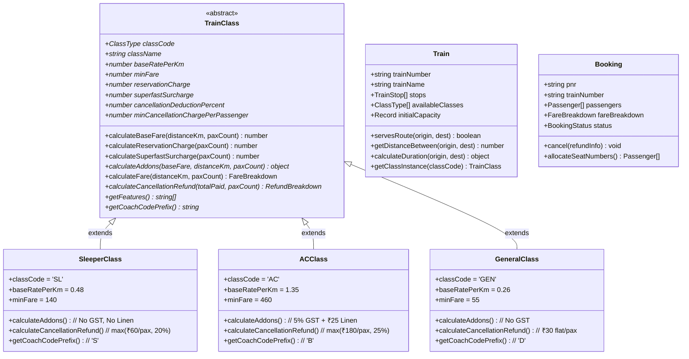

# RailEase 🚆
### Modern Indian Railway Ticket Booking System (College Project)

**RailEase** is a complete, polished, fully functional web application designed for a college project simulating the Indian Railways reservation portal (IRCTC-style). Built using **React + TypeScript + Vite**, it implements a genuine **Object-Oriented Programming (OOP) inheritance hierarchy**, client-side **localStorage persistence**, atomic seat inventory tracking, simulated payment gateways, cancellation refund algorithms, and authentic printable Electronic Reservation Slips (ERS).

---

## 🌟 Key Features

1. **Station & Intermediate Route Matching**:
   - Predefined major Indian stations including **Vijayawada (BZA)**, **Secunderabad / Hyderabad (SC)**, **Visakhapatnam (VSKP)**, **Chennai Central (MAS)**, **KSR Bengaluru (SBC)**, **Tirupati Main (TPTY)**, **Mumbai CSMT (CSMT)**, **New Delhi (NDLS)**, **Pune (PUNE)**, **Bhubaneswar (BBS)**, and **Howrah / Kolkata (HWH)**.
   - 10+ sequenced trains with multiple intermediate stops.
   - Enforces strict **directional travel order** (the boarding station must appear strictly before the destination stop in the train's route sequence).

2. **Genuine OOP & Polymorphic Class Hierarchy**:
   - Abstract base class `TrainClass` defining common fare calculation algorithms (Template Method pattern).
   - Three specialized subclasses: `SleeperClass`, `ACClass`, and `GeneralClass`.
   - Polymorphic method overrides for base rates per kilometer, reservation fees, superfast surcharges, linen/sanitization addons, 5% GST on AC coaches, and class-specific cancellation deduction rules.

3. **Atomic Seat Inventory & Cancellation Restoration**:
   - Dedicated inventory tracked per `trainNumber + journeyDate + travelClass`.
   - Persisted across browser sessions in versioned `localStorage`.
   - Prevents overbooking and double-submission.
   - When a ticket is cancelled, seats are restored **exactly once** and capped at the train's initial capacity (preventing inventory inflation).

4. **Step-by-Step Passenger Booking Flow**:
   - **Step 1**: Dynamic passenger details form (1 to 6 passengers) with name, age (1–120), gender, berth preference (Lower, Middle, Upper, Side Lower, Side Upper, Window), and contact details.
   - **Step 2**: Journey summary and itemized fare breakdown calculated by the OOP model.
   - **Step 3**: Simulated payment step (UPI, Card, Net Banking) with explicit notice that no real funds are charged.

5. **Authentic IRCTC-Style Printable ERS Ticket**:
   - 10-digit Indian Railway format PNR (e.g. `842-1948291`).
   - Automated coach & berth allocation (e.g. `B1-12 (Lower)` or `S2-24 (Middle)`).
   - Full printable view (`window.print()`) styled specifically for clean A4 printing without UI controls.

6. **My Bookings & PNR Status Enquiry**:
   - Complete booking history with filter tabs: *All*, *Confirmed / Active*, and *Cancelled*.
   - Instant PNR search bar.
   - Working ticket cancellation dialog computing real-time refunds based on class rules.
   - Global PNR enquiry modal accessible from the navbar at any time.

---

## 🏛️ Object-Oriented Architecture & Inheritance

The application highlights core OOP principles: **Abstraction**, **Inheritance**, **Polymorphism**, and **Encapsulation**.



### Class Hierarchy Details

| Class | Base Rate / km | Min Fare | Reservation Charge | Add-ons | Cancellation Deduction | Coach Prefix |
| :--- | :---: | :---: | :---: | :---: | :---: | :---: |
| **SleeperClass** (`SL`) | ₹0.48 | ₹140 | ₹20 / pax | ₹0 GST, ₹0 Linen | Max(₹60/pax, 20%) | `S` (e.g. S3-42) |
| **ACClass** (`AC`) | ₹1.35 | ₹460 | ₹40 / pax | **5% GST** + ₹25 Linen pack | Max(₹180/pax, 25%) | `B` (e.g. B1-18) |
| **GeneralClass** (`GEN`) | ₹0.26 | ₹55 | ₹15 / pax | ₹0 GST, ₹0 Linen | Flat ₹30 / pax | `D` (e.g. D2-15) |

---

## 📁 Project Directory Structure

```text
railease/
├── index.html                    # HTML shell with viewport, train SVG favicon, & title
├── package.json                  # Scripts & minimal dependencies (React 18 + Vite + TS)
├── pnpm-workspace.yaml           # Package manager configuration
├── tsconfig.json                 # TypeScript compiler configuration
├── vite.config.ts                # Vite React build configuration
├── scripts/
│   └── run-tests.mjs             # Test runner executing 42 verification tests
├── src/
│   ├── main.tsx                  # React DOM mount point
│   ├── App.tsx                   # Main orchestrator with state & routing
│   ├── data/
│   │   ├── stations.ts           # Predefined Indian railway stations (BZA, SC, MAS, etc.)
│   │   └── sampleTrains.ts       # 10+ realistic sequenced train route datasets
│   ├── models/
│   │   ├── types.ts              # Central TypeScript interfaces & types
│   │   ├── TrainClass.ts         # Abstract base class for fare & refund calculations
│   │   ├── SleeperClass.ts       # Concrete subclass for Sleeper (SL)
│   │   ├── ACClass.ts            # Concrete subclass for AC 3 Tier / Chair Car
│   │   ├── GeneralClass.ts       # Concrete subclass for General / 2S
│   │   ├── TrainClassFactory.ts  # Factory method pattern instantiating train classes
│   │   ├── Train.ts              # Train domain model with route & distance logic
│   │   └── Booking.ts            # Booking model with lifecycle & seat allocation
│   ├── services/
│   │   ├── storageService.ts     # Versioned localStorage with error resilience
│   │   ├── inventoryService.ts   # Atomic seat inventory decrement & restore logic
│   │   ├── searchService.ts      # Multi-station route search & sorting engine
│   │   └── bookingService.ts     # PNR generation, validation, & reservation manager
│   ├── components/
│   │   ├── Icons.tsx             # Clean, dependency-free inline SVG icons
│   │   ├── Navbar.tsx            # Sticky navigation bar with mobile responsive toggle
│   │   ├── HeroBanner.tsx        # Hero section with college project tags
│   │   ├── SearchForm.tsx        # Station select dropdowns, swap button, date picker
│   │   ├── TrainResultCard.tsx   # Train route cards with live seat badges & fares
│   │   ├── BookingModal.tsx      # 3-step modal (Passengers ➔ Fare review ➔ Payment)
│   │   ├── TicketConfirmation.tsx# Printable IRCTC ERS ticket confirmation slip
│   │   ├── MyBookings.tsx        # Booking history, status filters, & cancellation
│   │   ├── PNRStatusModal.tsx    # Dedicated 10-digit PNR lookup modal
│   │   └── Footer.tsx            # Indian railway portal footer & architecture info
│   ├── styles/
│   │   └── index.css             # Navy-blue & orange Indian Railways theme & print CSS
│   └── test/
│       └── verify.ts             # 42 unit tests verifying OOP, fares, routes, & inventory
└── README.md
```

---

## 🚀 Setup & Execution Guide

### 1. Prerequisites
Ensure you have Node.js (v18+) installed.

### 2. Run the Development Server
From the project folder:
```bash
npm run dev
```
*(or with pnpm: `pnpm run dev`)*

Open your browser at the displayed local URL (typically **`http://localhost:5173`**).

### 3. Run Verification Tests
To run the automated 42-test test suite verifying OOP inheritance, fare calculations, and inventory behavior:
```bash
npm test
```
*(or with pnpm: `pnpm test`)*

### 4. Create Production Build
```bash
npm run build
```
Generates an optimized production bundle in the `dist/` directory with zero errors.

---

## 🧪 Demonstration Walkthrough (For College Evaluator)

To demonstrate the full project during evaluation:

1. **Search Trains**:
   - Select **From**: `Vijayawada (BZA)` and **To**: `Chennai (MAS)`.
   - Pick any future date (or today).
   - Click **Find Trains**.
   - Notice the train results showing *Charminar SF*, *Pinakini SF*, and *Coromandel Express*.
   - Check the class options: **Sleeper (SL)**, **AC (AC)**, and **General (GEN)** with live seat badges.

2. **Test Route Directionality**:
   - Now select **From**: `Chennai (MAS)` and **To**: `Vijayawada (BZA)`.
   - Observe that only Northbound trains (e.g. *Charminar Northbound* and *Kerala Express*) appear, correctly enforcing directional travel order.

3. **Demonstrate OOP Fare Calculation**:
   - Select a train and click **Book Now (AC)**.
   - Enter passenger details (e.g. 2 passengers).
   - In Step 2, observe the itemized fare breakdown:
     - Notice AC adds **5% GST** and **₹25 linen pack charge** per passenger.
     - Notice Sleeper has **0% GST** and **₹0 linen**.

4. **Complete Reservation**:
   - Choose a payment mode (UPI / Card / Net Banking) in the demo payment step.
   - Click **Simulate Pay & Book Ticket**.
   - Instant generation of a unique 10-digit PNR (e.g. `842-3849120`) and assigned berths (e.g. `B1-12 (Lower)`).
   - Click **Print Official Ticket** to preview the clean, print-ready A4 ticket layout.

5. **Verify Inventory Decrement & Cancellation**:
   - Search the same train again and notice the available seat count has decreased by the number of booked passengers.
   - Go to **My Bookings**.
   - Click **Cancel Reservation**.
   - Observe the refund modal displaying the class-specific deduction.
   - Confirm cancellation: ticket status changes to `CANCELLED` and seats are restored immediately to inventory.
